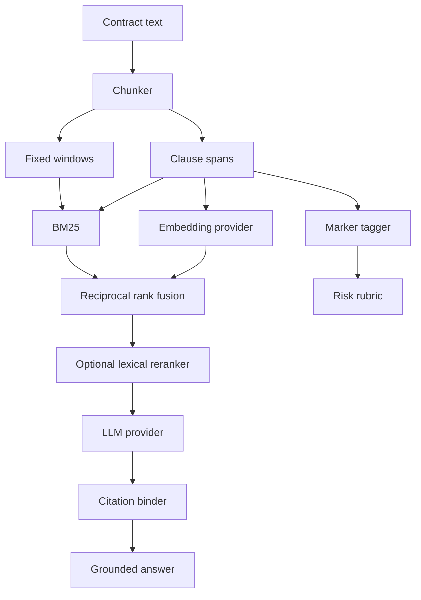

# ArbiLens

ArbiLens answers questions about a contract by retrieving the clause that supports the answer and citing that clause by character offset. A deterministic tagger and risk rubric sit next to the reader, so a score does not depend on a model choosing one. The default path is an offline fake embedder and an extractive reader: clone the repo, install the package, and run the evaluation with no API key, database, or network.

The same rubric and clause markers back a FastAPI application for upload, review, and export. That application is the product shell. The retrieval engine is what the evaluation measures.

## Quickstart

Python 3.11 or newer. From a clean checkout:

```bash
python3 -m venv .venv
source .venv/bin/activate
python -m pip install -e "backend[dev]"
arbilens eval
arbilens ask eval/data/contracts/harbor-msa.txt "Which ceiling bounds monetary exposure?"
```

`arbilens eval` prints the table below, writes `eval/reports/latest.json` and `eval/reports/latest.md`, and exits 0 when the checked-in thresholds hold. The ask command prints a sentence copied from the contract and the character span it came from. Both commands use the offline provider. Nothing in this quickstart calls an external API.

To use a real endpoint for `arbilens ask` only:

```bash
export ARBILENS_LLM_PROVIDER=openai
export ARBILENS_EMBEDDING_PROVIDER=openai
export ARBILENS_OPENAI_BASE_URL=https://api.openai.com/v1
export OPENAI_API_KEY=sk-...
export ARBILENS_LLM_MODEL=gpt-4.1-mini
export ARBILENS_EMBEDDING_MODEL=text-embedding-3-small
```

Any server that implements `POST /embeddings` and `POST /chat/completions` works. `arbilens eval` still uses the fake provider, so the gate does not change when a key is present.

## Architecture



Detail is in [docs/ARCHITECTURE.md](docs/ARCHITECTURE.md).

## Design decisions

Clause-aware chunking. The baseline cuts the file into 320-character windows with no overlap. The upgraded chunker cuts on headings such as `2. Payment Terms` and keeps each clause as one slice of the original string. A window that crosses a sentence can contain neither the full sentence nor the clause it belongs to. Citations need the second kind of span.

Hybrid retrieval with reciprocal rank fusion. BM25 is the right tool when the question repeats the contract's words, and it returns nothing when the question is only a synonym. The offline embedder maps a fixed list of legal phrases onto shared dimensions so "monetary exposure" and "aggregate liability" meet. Those scores are not comparable, so fusion uses rank: `1 / (60 + rank)` from each list a chunk appears in. A chunk missing from one list is not given a fake zero that drags it down.

The reranker is optional and small. It adds a lexical bonus on top of the fused score. The bonus can swap a near tie. It is not a cross-encoder, and on this dataset the fusion order is already enough for the headline metrics. The unit tests cover the reorder; the eval does not pretend the reranker is what moved the table.

Grounding. The reader may only quote a substring of a retrieved passage. The binder drops anything else and records the quote's character offsets in the original document. `Grounded: yes` means the offsets match and the answer's numbers appear in the quote. It does not mean the quote answers the question. The evaluation's citation faithfulness checks the second part against a gold evidence sentence. There is no second model in that check.

Risk scores stay deterministic. The rules in `backend/app/engine/risks.py` own the code, the severity, and the recommendation. The FastAPI scorer calls those rules and may attach an explanation from the existing OpenAI Responses client. The explanation cannot replace the score. That split was already the design of the API; the engine now shares the rule text so the CLI and the API cannot diverge.

## Evaluation

Provider: `fake` (hashed embeddings with a legal-concept list, and an extractive reader). Six original contracts, twelve questions. Regenerate with `arbilens eval`. The definition of each metric is in [docs/EVALS.md](docs/EVALS.md).

```text
provider=fake  contracts=6  questions=12
metric                     baseline   upgraded      delta
---------------------------------------------------------
retrieval recall@5            0.500      1.000      0.500
retrieval MRR                 0.500      1.000      0.500
clause span F1                0.027      1.000      0.973
clause type F1                0.880      1.000      0.120
citation faithfulness         0.500      1.000      0.500
offset integrity              1.000      1.000      0.000
risk-flag accuracy            0.500      1.000      0.500
risk-flag F1                  0.842      1.000      0.158
```

How to read this. Upgraded span F1 is 1.000 because the gold clauses are the numbered sections, the chunker keeps those sections, and each section contains the marker the tagger uses. That is the pipeline agreeing with its own labels, not a lawyer agreeing with the model. Baseline type F1 stays at 0.880 because a window still catches the heading. Baseline span F1 falls apart because a 320-character window cannot cover the longer clauses at the 0.5 intersection-over-union cutoff. Recall and faithfulness move from 0.500 to 1.000: the lexical questions that fit in a window are answerable either way, and the synonym and boundary-crossing questions are not. Offset integrity is 1.000 for both, which is the binder doing its job even when the quote is the wrong clause.

Per-type span F1 is in the JSON report. Baseline is 0 except `payment_terms` at 0.250, where one short clause was aligned to a window on purpose.

## Tests and CI

```bash
cd backend
ruff check app && ruff format --check app
mypy app
pytest
```

`pytest` enforces 85% coverage on `app`. GitHub Actions runs those commands, the frontend typecheck and tests, and `arbilens eval --check`.

## Web application

The API, worker, and UI are still here. They need Postgres, Redis, and object storage:

```bash
cp backend/.env.example backend/.env
cp frontend/.env.example frontend/.env.local
docker compose -f infra/docker-compose.yml up --build
```

Frontend at `http://localhost:3000`, API at `http://localhost:8000`, OpenAPI at `http://localhost:8000/docs`. Notes on that stack: [docs/development.md](docs/development.md), [docs/deployment.md](docs/deployment.md), [docs/design-decisions.md](docs/design-decisions.md), [docs/reliability.md](docs/reliability.md).

## Limitations

- The offline embedder only generalizes across the concept list in `backend/app/engine/concepts.py`. It will not retrieve a paraphrase that list does not mention.
- Upgraded scores of 1.000 are on a set written for these rules. They will not survive an arbitrary contract.
- Citation faithfulness checks that the gold sentence is inside the quote. It does not check entailment of a paraphrase.
- The tagger is a marker list. A clause that avoids those words is missed, and a window that contains a marker is labeled even when the operative sentence is elsewhere.
- The worker's normalizer still builds its own chunks for stored documents. The engine is not wired into that pipeline, so upload results are not the eval's clause spans.
- No OCR. Scanned PDFs are out of scope.
- The web application's auth, billing, and webhook handling are unchanged and still have the limits described in the older notes.

## Roadmap

- Run the same questions through the OpenAI-compatible providers and publish that report next to the fake one, without letting it replace the offline gate.
- Predict a sentence span inside a clause instead of labeling the whole section.
- Ask a stored document from the API using the same binder the CLI uses.
- OCR for image-only PDFs, as a separate parser in front of the same chunker.
