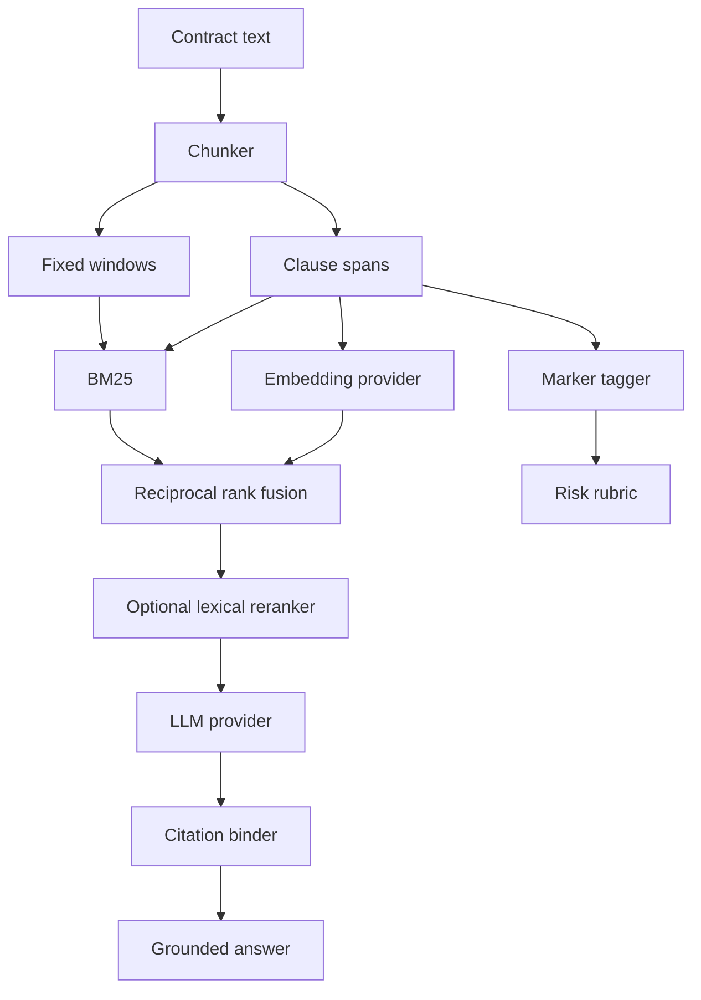

# ArbiLens

ArbiLens answers questions about a contract by retrieving the clause that supports the answer and citing that clause by character offset. A deterministic tagger and risk rubric sit next to the reader, so a score does not depend on a model choosing one. The default path is an offline fake embedder and an extractive reader: clone the repo, install the package, and run the evaluation with no API key, database, or network.

The same rubric and clause markers back a FastAPI application for upload, review, and export. That application is the product shell. The retrieval engine is what the evaluation measures.

## Quickstart

Python 3.11 or newer. From a clean checkout:

```bash
python3 -m venv .venv
source .venv/bin/activate
python -m pip install -e "backend[dev]"
arbilens eval
arbilens ask eval/data/contracts/harbor-msa.txt "Which ceiling bounds monetary exposure?"
```

`arbilens eval` prints the table below and writes `eval/reports/latest.json` and `eval/reports/latest.md`. `arbilens eval --check` exits 1 when those numbers fall through `eval/thresholds.json`. The ask command prints a sentence copied from the contract and the character span it came from. Both commands use the offline provider. Nothing in this quickstart calls an external API.

To use a real endpoint for `arbilens ask` only:

```bash
export ARBILENS_LLM_PROVIDER=openai
export ARBILENS_EMBEDDING_PROVIDER=openai
export ARBILENS_OPENAI_BASE_URL=https://api.openai.com/v1
export OPENAI_API_KEY=sk-...
export ARBILENS_LLM_MODEL=gpt-4.1-mini
export ARBILENS_EMBEDDING_MODEL=text-embedding-3-small
```

Any server that implements `POST /embeddings` and `POST /chat/completions` works. `arbilens eval` still uses the fake provider, so the gate does not change when a key is present.

## Architecture



Detail is in [docs/ARCHITECTURE.md](docs/ARCHITECTURE.md).

## Design decisions

Clause-aware chunking. The baseline cuts the file into 320-character windows with no overlap. The upgraded chunker cuts on headings such as `2. Payment Terms` and keeps each clause as one slice of the original string. A window that crosses a sentence can contain neither the full sentence nor the clause it belongs to. Citations need the second kind of span.

Hybrid retrieval with reciprocal rank fusion. BM25 is the right tool when the question repeats the contract's words, and it returns nothing when the question is only a synonym. The offline embedder maps a fixed list of legal phrases onto shared dimensions so "monetary exposure" and "aggregate liability" meet. Those scores are not comparable, so fusion uses rank: `1 / (60 + rank)` from each list a chunk appears in. A chunk missing from one list is not given a fake zero that drags it down.

The reranker is optional and small. It adds a lexical bonus on top of the fused score. The bonus can swap a near tie. It is not a cross-encoder. Embeddings enter fusion at 0.45 times the BM25 weight. That weight, and scoring each clause by its best sentence, were chosen on the tuning set so a shorter distractor does not outrank a longer clause that contains more of the question.

Grounding. The reader may only quote a substring of a retrieved passage. The binder drops anything else and records the quote's character offsets in the original document. `Grounded: yes` means the offsets match and the answer's numbers appear in the quote. Citation faithfulness is a separate check: a deterministic judge asks whether a paraphrased claim, which is not a sentence from the contract, is supported by those quotes. It counts a word as supported when the quote contains it or when both sides trigger the same entry in the concept list, and it rejects a cap that the quote contradicts. An OpenAI-compatible judge implements the same interface when `ARBILENS_JUDGE_PROVIDER=openai`. The eval gate does not use it. The offline judge misses paraphrases outside the concept list and can accept a long quote that mentions the facts for the wrong reason.

Risk scores stay deterministic. The rules in `backend/app/engine/risks.py` own the code, the severity, and the recommendation. The FastAPI scorer calls those rules and may attach an explanation from the existing OpenAI Responses client. The explanation cannot replace the score. That split was already the design of the API; the engine now shares the rule text so the CLI and the API cannot diverge.

## Evaluation

Provider: `fake`. Judge: `deterministic` (lexical and concept overlap, not a model). Regenerate with `arbilens eval`. Definitions and labeling rules are in [docs/EVALS.md](docs/EVALS.md).

The dev set is the original six contracts. It was written so numbered headings, marker words, and the concept list line up with the pipeline. High dev scores mean that alignment held. They are not a claim about unseen contracts.

The tuning set is where heading, stemming, and fusion choices were made. It includes the three contracts from the first small held-out set, which had already been inspected, plus four short notes. The held-out set is twelve later contracts and forty-eight questions. It was frozen before those changes. Parameters were never tuned on the held-out set.

`previous` below is the upgraded pipeline recorded in `eval/reports/previous-upgraded.json` before this round's heading and fusion changes. `upgraded` is the current pipeline. Baseline is fixed windows plus BM25, using the current tagger.

```text
split=dev
provider=fake  judge=deterministic  contracts=6  questions=12
metric                     baseline   upgraded      delta
---------------------------------------------------------
retrieval recall@1            0.500      1.000      0.500
retrieval recall@5            0.500      1.000      0.500
retrieval MRR                 0.500      1.000      0.500
clause span F1                0.027      1.000      0.973
clause type F1                0.907      1.000      0.093
citation faithfulness         0.500      1.000      0.500
offset integrity              1.000      1.000      0.000
risk-flag accuracy            0.500      1.000      0.500
risk-flag F1                  0.842      1.000      0.158
```

Previous upgraded on dev was already 1.000 on every headline metric. It stayed there.

```text
split=tuning
provider=fake  judge=deterministic  contracts=7  questions=13
metric                     baseline   upgraded      delta
---------------------------------------------------------
retrieval recall@1            0.846      0.846      0.000
retrieval recall@5            0.846      1.000      0.154
retrieval MRR                 0.846      0.887      0.041
clause span F1                0.000      0.762      0.762
clause type F1                0.800      0.857      0.057
citation faithfulness         0.769      0.769      0.000
offset integrity              1.000      1.000      0.000
risk-flag accuracy            0.714      0.714      0.000
risk-flag F1                  0.944      0.944      0.000
```

Previous upgraded on tuning: recall@1 0.769, span F1 0.000, type F1 0.700, faithfulness 0.769. Recall@1 now matches baseline instead of trailing it. Span F1 moved from 0.000 to 0.762.

```text
split=heldout
provider=fake  judge=deterministic  contracts=12  questions=48
metric                     baseline   upgraded      delta
---------------------------------------------------------
retrieval recall@1            0.792      0.917      0.125
retrieval recall@5            0.792      1.000      0.208
retrieval MRR                 0.792      0.949      0.157
clause span F1                0.066      0.871      0.805
clause type F1                0.918      0.968      0.050
citation faithfulness         0.708      0.833      0.125
offset integrity              1.000      1.000      0.000
risk-flag accuracy            0.750      0.833      0.083
risk-flag F1                  0.952      0.969      0.016
```

Previous upgraded on this frozen held-out set: recall@1 0.917, recall@5 1.000, MRR 0.951, span F1 0.295, type F1 0.918, faithfulness 0.792, risk accuracy 0.833, risk F1 0.969. The new pipeline keeps rank-1 recall and lifts span F1 by 0.576 and faithfulness by 0.041. MRR moves from 0.951 to 0.949.

Held-out recall@1 by heading style, upgraded: all-caps 1.000, roman 1.000, lettered 1.000, inline 1.000, run-on 1.000, combined sentence 1.000, numbered 0.900, title case 0.667, article-with-dash 0.500. Upgraded span recall for those styles is 1.000 for all-caps, roman, inline, and title case; 0.800 numbered; 0.750 lettered; 0.500 article-with-dash and combined sentence. Assignment span F1 is 0.000. The other clause types on this set are at 0.500 or above, and most are 1.000. The full per-type table is in `eval/reports/latest.md`.

Three failures that remain on the upgraded path:

- Kelp asks what Kelp Goods can be asked to pay when an ordinary accident happens. `2. Credits` repeats that wording and is cited. The cap is the sentence under `Article IV — Compensation`, which is now its own chunk, and the judge scores the credit quote at 12% overlap. A distractor that copies the question still beats a paraphrase of the cap.
- Flint asks whether the supply renews automatically. The renewal sentence says "automatic renewal". The question says "renew automatically". BM25 is not stemmed, the termination sentence also says "supply", and that sentence is cited. Marker stemming fixed `invoice` versus `invoices`. It does not fix retrieval.
- Nile's governing-law sentence is cited correctly: the agreement is governed by the laws of Maine. The claim says "Maine law governs the agreement." The deterministic judge shares only half the tokens, because it does not stem `law`/`laws` or `governs`/`governed`, and it rejects the claim.

## Tests and CI

```bash
cd backend
ruff check app && ruff format --check app
mypy app
pytest
```

`pytest` enforces 85% coverage on `app`. GitHub Actions runs those commands, the frontend typecheck and tests, and `arbilens eval --check`.

## Web application

The API, worker, and UI are still here. They need Postgres, Redis, and object storage:

```bash
cp backend/.env.example backend/.env
cp frontend/.env.example frontend/.env.local
docker compose -f infra/docker-compose.yml up --build
```

Frontend at `http://localhost:3000`, API at `http://localhost:8000`, OpenAPI at `http://localhost:8000/docs`. Object storage is `adobe/s3mock` on port 9090. `minio/minio` could not be pulled from Docker Hub, and the mock's `initialBuckets` setting did not create a bucket, so `s3-init` creates `arbilens-documents`. A smoke test against this stack registered a user, uploaded a DOCX, waited for the worker, and `POST /api/v1/documents/{id}/ask` returned the unlimited-liability sentence at characters 27–97 under `1. Limitation of Liability`. Notes: [docs/development.md](docs/development.md), [docs/deployment.md](docs/deployment.md), [docs/design-decisions.md](docs/design-decisions.md), [docs/reliability.md](docs/reliability.md).

## Limitations

- Dev scores of 1.000 are on contracts written for numbered headings, marker words, and the concept list. The held-out table is the one to read. Parameters were never tuned on the held-out set.
- The offline embedder only generalizes across `backend/app/engine/concepts.py`. A distractor that copies the question still outranks a paraphrase with different words, as Kelp shows.
- The deterministic faithfulness judge is not entailment. It misses paraphrases outside the concept list, including "Maine law governs" for "governed by the laws of Maine", and it can accept a long quote that contains both duties.
- Marker matching is stemmed, and `assignment` in a heading is not the same as "this assignment" in a sentence. BM25 itself is not stemmed, so "renew automatically" can miss "automatic renewal".
- A section that holds two sentences is still one span unless it exceeds the oversized-section limit. A gold sentence inside that section can miss the 0.5 IoU cutoff. Combined sentences are the same shape.
- No OCR. Scanned PDFs are out of scope.
- The web application's auth, billing, and webhook handling are unchanged and still have the limits described in the older notes.

## Roadmap

- Run the same questions through the OpenAI-compatible providers and publish that report next to the fake one, without letting it replace the offline gate.
- Stem the retriever, not only the marker list, and publish the tuning-set comparison before touching the held-out floors.
- Predict a sentence span inside a short section, so a gold sentence that shares its section with a second sentence can clear IoU 0.5.
- OCR for image-only PDFs, as a separate parser in front of the same chunker.
