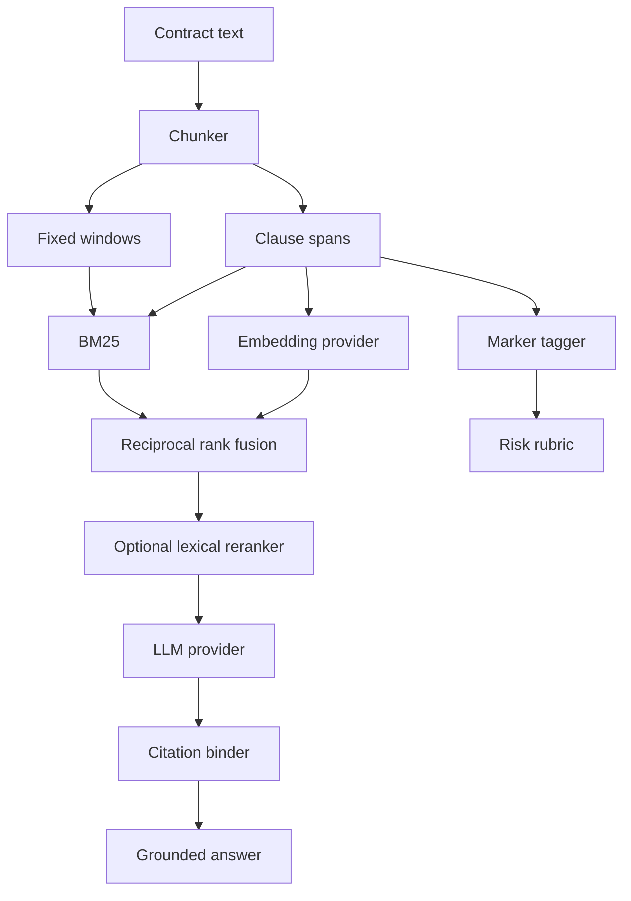

# ArbiLens

ArbiLens answers questions about a contract by retrieving the clause that supports the answer and citing that clause by character offset. A deterministic tagger and risk rubric sit next to the reader, so a score does not depend on a model choosing one. The default path is an offline fake embedder and an extractive reader: clone the repo, install the package, and run the evaluation with no API key, database, or network.

The same rubric and clause markers back a FastAPI application for upload, review, and export. That application is the product shell. The retrieval engine is what the evaluation measures.

## Quickstart

Python 3.11 or newer. From a clean checkout:

```bash
python3 -m venv .venv
source .venv/bin/activate
python -m pip install -e "backend[dev]"
arbilens eval
arbilens ask eval/data/contracts/harbor-msa.txt "Which ceiling bounds monetary exposure?"
```

`arbilens eval` prints the table below and writes `eval/reports/latest.json` and `eval/reports/latest.md`. `arbilens eval --check` exits 1 when those numbers fall through `eval/thresholds.json`. The ask command prints a sentence copied from the contract and the character span it came from. Both commands use the offline provider. Nothing in this quickstart calls an external API.

To use a real endpoint for `arbilens ask` only:

```bash
export ARBILENS_LLM_PROVIDER=openai
export ARBILENS_EMBEDDING_PROVIDER=openai
export ARBILENS_OPENAI_BASE_URL=https://api.openai.com/v1
export OPENAI_API_KEY=sk-...
export ARBILENS_LLM_MODEL=gpt-4.1-mini
export ARBILENS_EMBEDDING_MODEL=text-embedding-3-small
```

Any server that implements `POST /embeddings` and `POST /chat/completions` works. `arbilens eval` still uses the fake provider, so the gate does not change when a key is present.

## Architecture



Detail is in [docs/ARCHITECTURE.md](docs/ARCHITECTURE.md).

## Design decisions

Clause-aware chunking. The baseline cuts the file into 320-character windows with no overlap. The upgraded chunker cuts on headings such as `2. Payment Terms` and keeps each clause as one slice of the original string. A window that crosses a sentence can contain neither the full sentence nor the clause it belongs to. Citations need the second kind of span.

Hybrid retrieval with reciprocal rank fusion. BM25 is the right tool when the question repeats the contract's words, and it returns nothing when the question is only a synonym. The offline embedder maps a fixed list of legal phrases onto shared dimensions so "monetary exposure" and "aggregate liability" meet. Those scores are not comparable, so fusion uses rank: `1 / (60 + rank)` from each list a chunk appears in. A chunk missing from one list is not given a fake zero that drags it down.

The reranker is optional and small. It adds a lexical bonus on top of the fused score. The bonus can swap a near tie. It is not a cross-encoder, and on this dataset the fusion order is already enough for the headline metrics. The unit tests cover the reorder; the eval does not pretend the reranker is what moved the table.

Grounding. The reader may only quote a substring of a retrieved passage. The binder drops anything else and records the quote's character offsets in the original document. `Grounded: yes` means the offsets match and the answer's numbers appear in the quote. Citation faithfulness is a separate check: a deterministic judge asks whether a paraphrased claim, which is not a sentence from the contract, is supported by those quotes. It counts a word as supported when the quote contains it or when both sides trigger the same entry in the concept list, and it rejects a cap that the quote contradicts. An OpenAI-compatible judge implements the same interface when `ARBILENS_JUDGE_PROVIDER=openai`. The eval gate does not use it. The offline judge misses paraphrases outside the concept list and can accept a long quote that mentions the facts for the wrong reason.

Risk scores stay deterministic. The rules in `backend/app/engine/risks.py` own the code, the severity, and the recommendation. The FastAPI scorer calls those rules and may attach an explanation from the existing OpenAI Responses client. The explanation cannot replace the score. That split was already the design of the API; the engine now shares the rule text so the CLI and the API cannot diverge.

## Evaluation

Provider: `fake`. Judge: `deterministic` (lexical and concept overlap, not a model). Regenerate with `arbilens eval`. Definitions and labeling rules are in [docs/EVALS.md](docs/EVALS.md).

The dev set is the original six contracts. It was written so numbered headings, marker words, and the concept list line up with the pipeline. High dev scores mean that alignment held. They are not a claim about unseen contracts.

```text
split=dev
provider=fake  judge=deterministic  contracts=6  questions=12
metric                     baseline   upgraded      delta
---------------------------------------------------------
retrieval recall@1            0.500      1.000      0.500
retrieval recall@5            0.500      1.000      0.500
retrieval MRR                 0.500      1.000      0.500
clause span F1                0.027      1.000      0.973
clause type F1                0.880      1.000      0.120
citation faithfulness         0.500      1.000      0.500
offset integrity              1.000      1.000      0.000
risk-flag accuracy            0.500      1.000      0.500
risk-flag F1                  0.842      1.000      0.158
```

The held-out set is three contracts written afterward: an unnumbered `Article IV — Payout` heading, a run-on sentence that states two duties, a title-case heading the chunker does not treat as a boundary, clauses with no taxonomy keyword, and questions whose words were given to a distractor instead of the answer. The upgrade does not win this set. Rank-1 retrieval is worse than BM25 alone.

```text
split=heldout
provider=fake  judge=deterministic  contracts=3  questions=5
metric                     baseline   upgraded      delta
---------------------------------------------------------
retrieval recall@1            0.600      0.400     -0.200
retrieval recall@5            0.600      1.000      0.400
retrieval MRR                 0.600      0.667      0.067
clause span F1                0.000      0.000      0.000
clause type F1                0.333      0.333      0.000
citation faithfulness         0.600      0.600      0.000
offset integrity              1.000      1.000      0.000
risk-flag accuracy            0.667      0.667      0.000
risk-flag F1                  0.941      0.941      0.000
```

Three failures, all on the upgraded path:

- Bramble asks what Bramble Goods can be asked to pay when an ordinary accident happens. Those words are in `2. Credits`, which is cited. The real cap is under `Article IV — Payout`, which the chunker glues onto `1. Orders` because it is not a numbered heading, and the sentence never says "limitation of liability". The judge scores the credit quote at 12% overlap and rejects it. The rubric then reports a missing liability cap.
- Yarrow asks who keeps the pictures made for this assignment after the bill is settled. `2. Tools` uses that wording and is cited. The drawings sentence sits under the title-case line `Ownership of new drawings`, inside the `1. Grant` chunk. The quote does not say Maple Press keeps the drawings.
- Willow puts payment and a covering promise in one sentence under `2. Money and promises`. Neither half matches a gold span at IoU 0.5, so span F1 is zero. The citation is that whole sentence, so the paraphrase judge accepts both claims. A quote can be faithful and still be the wrong span.

Recall@5 is 1.000 on the held-out set because each contract has only a handful of chunks. Recall@1 is the number that shows the miss.

## Tests and CI

```bash
cd backend
ruff check app && ruff format --check app
mypy app
pytest
```

`pytest` enforces 85% coverage on `app`. GitHub Actions runs those commands, the frontend typecheck and tests, and `arbilens eval --check`.

## Web application

The API, worker, and UI are still here. They need Postgres, Redis, and object storage:

```bash
cp backend/.env.example backend/.env
cp frontend/.env.example frontend/.env.local
docker compose -f infra/docker-compose.yml up --build
```

Frontend at `http://localhost:3000`, API at `http://localhost:8000`, OpenAPI at `http://localhost:8000/docs`. Object storage is `adobe/s3mock` on port 9090. `minio/minio` could not be pulled from Docker Hub, and the mock's `initialBuckets` setting did not create a bucket, so `s3-init` creates `arbilens-documents`. A smoke test against this stack registered a user, uploaded a DOCX, waited for the worker, and `POST /api/v1/documents/{id}/ask` returned the unlimited-liability sentence at characters 27–97 under `1. Limitation of Liability`. Notes: [docs/development.md](docs/development.md), [docs/deployment.md](docs/deployment.md), [docs/design-decisions.md](docs/design-decisions.md), [docs/reliability.md](docs/reliability.md).

## Limitations

- Dev scores of 1.000 are on contracts written for numbered headings, marker words, and the concept list. The held-out table is the one to read.
- The offline embedder only generalizes across `backend/app/engine/concepts.py`. The held-out rank-1 drop is the upgraded retriever preferring a distractor that shares the question's words.
- The deterministic faithfulness judge is not entailment. It misses paraphrases outside the concept list, and it accepts a run-on quote that happens to contain both duties, as Willow does.
- The tagger is a marker list. "invoice" does not match "invoices". "Article IV — Payout" is not a heading. "this assignment" is tagged as an assignment clause.
- Upload normalization uses the clause-aware chunker, and `POST /api/v1/documents/{id}/ask` cites the stored spans. Unrecognized headings are still glued to the previous section.
- No OCR. Scanned PDFs are out of scope.
- The web application's auth, billing, and webhook handling are unchanged and still have the limits described in the older notes.

## Roadmap

- Run the same questions through the OpenAI-compatible providers and publish that report next to the fake one, without letting it replace the offline gate.
- Predict a sentence span inside a clause instead of labeling the whole section, so a run-on sentence is not one citation.
- Teach the chunker a heading style only after it is specified generally, and re-measure the held-out set before moving any threshold.
- OCR for image-only PDFs, as a separate parser in front of the same chunker.
