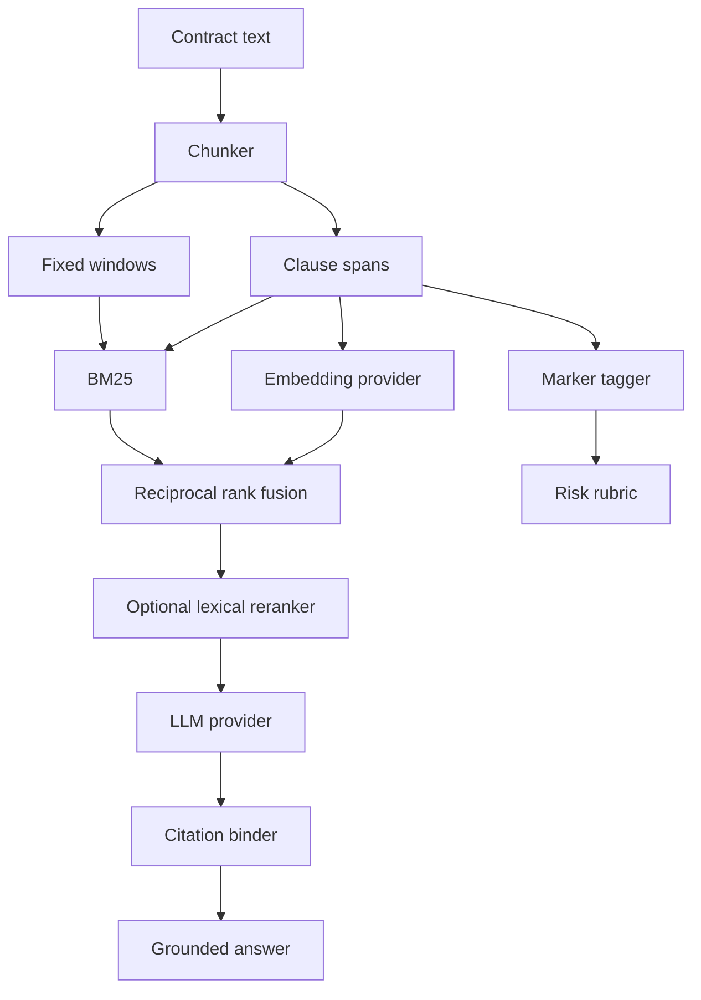

# Architecture

ArbiLens has two ways to run the same ideas.

The offline engine in `backend/app/engine` answers questions, tags clauses, and flags risks from a plain-text contract. It is what `arbilens` runs, and it is what the evaluation gate measures. It has no database and no network calls unless you opt into an OpenAI-compatible endpoint.

The FastAPI application in `backend/app` is the multi-tenant product: uploads, Postgres, Redis, Celery, and the Next.js UI. Parsing and persistence stay there. Clause markers and the risk rubric now live in the engine, and the API scorer calls that rubric so the two paths cannot drift.

## Offline path



`arbilens ask` does the following:

1. Chunk the contract. The upgraded strategy cuts on numbered headings (`1. Payment Terms`, `Section 4. Liability`). A chunk is an exact slice: `document[start:end] == chunk.text`. A clause longer than the configured maximum is split on paragraph breaks inside that clause, never across the next heading.
2. Retrieve. BM25 ranks chunks with a positive score. The embedding provider ranks by cosine similarity. Reciprocal rank fusion adds `1 / (60 + rank)` for each list a chunk appears in. A chunk that one retriever misses is not punished by a zero from that list; it simply gets no points from it.
3. Optionally rerank. The lexical reranker adds a small bonus for concept and token overlap. The bonus can reorder a near tie. It cannot overturn a clear fusion lead.
4. Read. The fake provider copies the best supporting sentence out of the top passages. The OpenAI-compatible provider must return JSON `{"answer", "citations": [{"chunk_id", "quote"}]}`.
5. Bind. A quote is kept only when it is an exact substring of the named passage. The citation's character offsets are that substring's position in the original document. The answer is marked grounded when those offsets match, the answer is lexically supported by the quotes, and every number in the answer also appears in a quote.

`arbilens analyze` stops after chunking, marker tagging, and the risk rubric. It does not call a model.

## Providers

```text
EmbeddingProvider.embed(texts) -> list[vector]
LLMProvider.answer(question, passages) -> answer + quotes
```

| Provider | When | What it does |
| --- | --- | --- |
| `fake` | default | Hashed token features plus a fixed list of legal concepts. The reader copies a sentence. |
| `openai` | `ARBILENS_*_PROVIDER=openai` | `POST {base}/embeddings` and `POST {base}/chat/completions` on any OpenAI-compatible server. |

`arbilens eval` ignores those variables and always builds the fake providers. The gate cannot change because a key happened to be in the environment.

The concept list is not a neural model. "Monetary exposure" and "aggregate liability" land on the same dimension because both phrases are listed under `liability_cap`. A question outside that list gets no synonym help until you point the embedder at a real model.

## Why these choices

Clause-aware chunks. A risk or a citation is about a clause, not about an arbitrary 320-character cut. Fixed windows are kept as the baseline so the eval can show what the boundary is worth. Windows do not overlap, so a sentence that crosses a cut is in no chunk at all.

Hybrid retrieval plus RRF. BM25 is precise when the question uses the contract's words. It scores zero when the question uses a synonym and nothing else. Embeddings cover that case. The two scores are not on the same scale, so fusion uses ranks rather than a weighted sum of raw scores. `k = 60` is the usual RRF constant.

Faithfulness. The eval does not ask a second model whether a citation "supports" a claim. It checks two mechanical facts: the citation offsets reproduce the quoted text, and the gold evidence sentence is inside that quote. The runtime `Grounded: yes` flag is the mechanical half only. It can be true for a quote that answers the wrong question. The labeled faithfulness number is the one that checks the question.

Shared rubric. `DeterministicRiskScoringService` used to inline the rules. It now builds a `ClauseView` list and calls `evaluate_risk_flags`. Scores, severities, and recommendation text are unchanged. The service still asks the existing Responses API client for an explanation and still refuses to let that explanation replace the score.

## What the web application still does

The upload pipeline is unchanged:

`parse_document_task -> normalize_document_task -> extract_clauses_task -> analyze_risks_task`

Normalization still cleans headers and builds paragraph-aligned chunks for the database. That chunker was not replaced. The offline engine works on the full text and records offsets into that string; the worker stores chunks that have already been cleaned. Mixing the two would have changed persisted clause text. The eval measures the engine, which is the path a reviewer can run.

The web application still uses Postgres, Redis, Celery, and S3-compatible storage. Its design notes remain in `docs/design-decisions.md`, `docs/reliability.md`, and `docs/deployment.md`.
